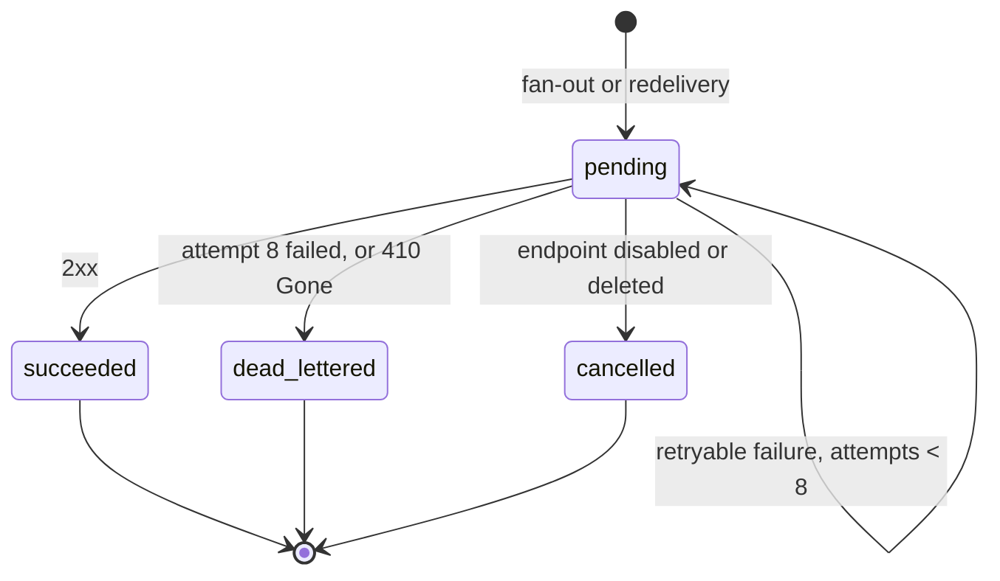

# ADR-008: Outbound webhooks — admin API, signing, secret storage, egress policy and delivery lifecycle

- **Status:** Accepted
- **Date:** 2026-11-27
- **Issue:** DUTH-140 (parent DUTH-43); implemented by DUTH-62 (API, consumer, worker) and DUTH-141 (admin screens)

## Context

ADR 006 fixed the integration event contract: CloudEvents 1.0 structured JSON, an ids-only payload, at-least-once delivery, and a `webhooks` consumer bound to every catalog type with `webhook: yes` (queue `webhooks.events`). It also fixed two webhook rules in advance: the HTTP call is retried from a **delivery row keyed by `(subscription, event_id)`**, and the CloudEvents `id` is sent as the `webhook-id` header.

ADR 006 left the rest open: the tenant-admin API, the signature, how a signing secret is stored, which hosts the dispatcher may call, and how deliveries retry, dead-letter and get redelivered. DUTH-62 is blocked until these are decided. This ADR makes those decisions. The machine-readable contract is [`docs/webhooks/openapi.yaml`](../webhooks/openapi.yaml) (OpenAPI 3.1). It holds both the admin paths and the outbound request, which sits under the top-level `webhooks:` object.

Constraints taken as given:

- Errors are RFC 9457 Problem Details ([`docs/api-errors.md`](../api-errors.md)). Idempotency follows [ADR-005](005-idempotency-keys.md). Write preconditions follow [ADR-007](007-conditional-requests.md).
- HMAC needs the raw key at signing time, so the secret must be recoverable. A hash, as used for calendar feed tokens, is not enough.
- ADR 003 lists OpenBao for stage 7 (DUTH-68). It is not in Compose today.
- Domain and application layers stay framework-free (`tests/architecture`).

## Decision

### 1. Admin API

All routes require the new permission **`webhook:manage`**, which is granted to `tenant_admin` only (`app/modules/identity/security.py`). Recruiters do not get it, because an endpoint sends tenant data to a third party. Other roles get 403 `forbidden`. Ids that belong to another tenant, or that don't exist, get 404 `not-found`.

| Method and path | Purpose | Idempotency-Key | If-Match |
| --- | --- | --- | --- |
| `GET /v1/webhook-event-types` | Subscribable catalog types (`webhook: yes` in AsyncAPI) with their status | — | — |
| `POST /v1/webhook-endpoints` | Create an endpoint and its subscriptions. **Returns the secret once.** | **Ignored**: the response contains a secret (same rule as calendar subscriptions in ADR-005) | — |
| `GET /v1/webhook-endpoints` | List endpoints, cursor paged, filter `status` | — | — |
| `GET /v1/webhook-endpoints/{endpoint_id}` | Endpoint detail, strong `ETag: "<version>"` | — | — |
| `PATCH /v1/webhook-endpoints/{endpoint_id}` | Change `url`, `description`, `event_types`, `enabled` | Supported; raw `If-Match` is part of the fingerprint (ADR-007 rule) | **Required** |
| `DELETE /v1/webhook-endpoints/{endpoint_id}` | Delete the endpoint (a tombstone), destroy its secrets, cancel pending deliveries | Not applicable (a retry gets 404) | **Required** |
| `POST /v1/webhook-endpoints/{endpoint_id}/secret-rotations` | New secret with a grace period for the old one. **Returns the new secret once.** | **Ignored**: the response contains a secret. If-Match prevents a double rotation. | **Required** |
| `GET /v1/webhook-endpoints/{endpoint_id}/deliveries` | Delivery log for one endpoint, filtered and cursor paged | — | — |
| `GET /v1/webhook-deliveries/{delivery_id}` | One delivery with all of its attempts | — | — |
| `POST /v1/webhook-deliveries/{delivery_id}/redeliveries` | Manual redelivery (§5) | Supported | — |

`If-Match` behaves exactly as in ADR-007. One exception: there is no legacy body version, so a missing header is always 428 `precondition-required`. A stale header is 412 `precondition-failed` with the current `ETag`, and a malformed one is 400 `invalid-precondition`. Every write increments `webhook_endpoints.version`, and so does a worker auto-disable, so an admin form that is still open receives 412.

Rules for the request body (the full schemas are in OpenAPI):

- `url`: must pass the registration-time checks in §4, with at most 2048 characters. Two non-deleted endpoints in one tenant cannot share a URL: 409 `conflict`.
- `event_types`: 1 to 20 distinct values, each a type from `GET /v1/webhook-event-types`. Anything else is 422 `validation-error` with pointer `/event_types/<i>`. Types with status `reserved` may be subscribed to; they start flowing when their publisher ships. There are no wildcards: a tenant opts in explicitly to each type.
- `description`: optional, at most 200 characters, no control characters.
- A tenant has at most **10** non-deleted endpoints: 409 `webhook-endpoint-limit-reached`.
- PATCH with `enabled: true` re-enables an endpoint and clears `disabled_reason` and the failure streak. PATCH with `enabled: false` sets `disabled_reason = manual` and cancels pending deliveries (§5).

Lists use the existing shape `{items, next_cursor}`, with `limit` 1–100 (default 25) and an opaque cursor. They are ordered `created_at DESC, id DESC`. Delivery-log filters:

- `status` (repeatable)
- `event_type`
- `event_id`
- `created_from` / `created_to` (RFC 3339; the range is half-open)

Every secret-bearing response sets `Cache-Control: no-store`, like the other write responses. Create, update, delete, rotate and redeliver each write an audit entry with the endpoint id, the URL **host only**, the event types, the secret id and the actor. The audit entry never holds the secret, the URL path or the query, because receivers often put a token in the query string.

New problem types in `docs/api-errors.md`:

- `webhook-url-not-allowed` (422): the URL breaks a §4 rule. `errors[0].pointer = /url`, and `detail` names the rule but never the resolved address.
- `webhook-endpoint-limit-reached` (409).
- `delivery-not-redeliverable` (409): the delivery is not terminal, the endpoint is not `enabled`, or another delivery of the same event to the same endpoint is still pending.

### 2. Signing: Standard Webhooks, HMAC-SHA256

The format is the [Standard Webhooks](https://www.standardwebhooks.com/) specification. It is HMAC-SHA256 over the message id, the timestamp and the raw body, and receivers can verify it with off-the-shelf libraries in most languages. It already uses the `webhook-id` header that ADR 006 committed to.

The outbound request:

```http
POST <endpoint url>
Content-Type: application/cloudevents+json; charset=utf-8
User-Agent: TalentFlow-Webhooks/1
webhook-id: <CloudEvents id, a UUID>
webhook-timestamp: <Unix seconds when this attempt was signed>
webhook-signature: v1,<base64 sig> [v1,<base64 sig>]

<the CloudEvents event from ADR 006, structured JSON, at most 256 KiB>
```

- **Signed content:** `"{webhook-id}.{webhook-timestamp}." + raw body bytes`. The signature is `base64(HMAC-SHA256(key, signed content))`.
- **Secret format:** `whsec_` followed by the base64 of 32 bytes from `secrets.token_bytes(32)`. The HMAC key is the decoded 32 bytes.
- **`webhook-signature`:** a space-separated list of `v1,<sig>`, one entry per active secret (§3). During a rotation grace period it carries two signatures. A receiver accepts the message if **any** entry matches.
- **Re-signing:** every attempt is signed again with a fresh timestamp, so a retry 6 hours later is still inside the window.
- **Replay window:** receivers reject a timestamp more than **300 seconds** from their own clock, in either direction. Inside the window they deduplicate on `webhook-id`. That id is the CloudEvents `id`, so it is identical across retries and redeliveries of the same event.
- **Body bytes:** the worker serializes the event once per delivery from the stored `webhook_events.body`, using compact separators and UTF-8, and signs exactly the bytes it sends. Receivers must verify the raw bytes before parsing them.
- **Other headers:** no cookies and no `Authorization` header. The dispatcher sends nothing else that is secret.

Sample verifier (Python standard library only; header names are lower-cased by the caller):

```python
import base64
import hashlib
import hmac
import time
from collections.abc import Mapping

TOLERANCE_SECONDS = 300


class InvalidWebhook(Exception):
    pass


def verify(secret: str, headers: Mapping[str, str], body: bytes, now: float | None = None) -> None:
    msg_id = headers["webhook-id"]
    timestamp = headers["webhook-timestamp"]
    if not timestamp.isdigit():
        raise InvalidWebhook("bad timestamp")
    current = time.time() if now is None else now
    if abs(current - int(timestamp)) > TOLERANCE_SECONDS:
        raise InvalidWebhook("timestamp outside tolerance")
    key = base64.b64decode(secret.removeprefix("whsec_"))
    signed = f"{msg_id}.{timestamp}.".encode() + body
    expected = base64.b64encode(hmac.new(key, signed, hashlib.sha256).digest()).decode()
    for entry in headers["webhook-signature"].split(" "):
        version, _, signature = entry.partition(",")
        if version == "v1" and hmac.compare_digest(signature, expected):
            return
    raise InvalidWebhook("no matching signature")
```

**Known-answer test vector.** DUTH-62 must assert this in a unit test, and receivers can use it to check their implementation:

| Input | Value |
| --- | --- |
| secret | `whsec_AAECAwQFBgcICQoLDA0ODxAREhMUFRYXGBkaGxwdHh8=` (bytes `0x00`…`0x1f`) |
| `webhook-id` | `0b7e1c9a-4f3d-4c55-9a52-3f1f6f3c2d10` |
| `webhook-timestamp` | `1795770000` (2026-11-27T09:00:00Z) |
| body | `{"specversion":"1.0","id":"0b7e1c9a-4f3d-4c55-9a52-3f1f6f3c2d10","source":"urn:talentflow:candidates","type":"candidate_case.stage_changed.v1","time":"2026-11-27T09:00:00Z","datacontenttype":"application/json","subject":"c-123","tenantid":"t-1","correlationid":"req-1","causationid":"req-1","data":{"candidate_case_id":"c-123","from_stage":"screening","to_stage":"interviewing","version":3}}` |
| `webhook-signature` | `v1,tf0j4MFE0WB8v3pV96njh8f00nDy2gSfd7KprE+McKU=` |

### 3. Secret storage and rotation

**Encryption at rest.** Secrets are encrypted with **AES-256-GCM in the application**, under a key-encryption key (KEK) taken from the environment. Encryption sits behind an application port, `WebhookSecretCipher` (`encrypt(plaintext, aad) -> str`, `decrypt(ciphertext, aad) -> bytes`), so the key source can change without touching the domain.

- Stored format: `tfgcm:v1:<kid>:<base64(nonce12 ‖ ciphertext ‖ tag16)>`, with a fresh 96-bit random nonce per encryption.
- **AAD** = `webhook-secret:{tenant_id}:{endpoint_id}:{secret_id}`. A ciphertext copied into another row or tenant fails to decrypt.
- **Keyring:**
  - `WEBHOOK_SECRET_KEYS` is a comma-separated list of `<kid>:<base64 of 32 bytes>`.
  - `WEBHOOK_SECRET_ACTIVE_KEY_ID` names the kid used for new encryptions. The other kids are decrypt-only.
  - Settings validation rejects a malformed or wrong-length key and an active kid that is missing from the ring. With `APP_ENV=production` it also rejects the Compose development key (kid `dev`).
  - KEK rotation: add a new kid, make it active, run the rewrap command DUTH-62 ships (`python -m app.workers.webhook_secret_rewrap`, batched, `FOR UPDATE SKIP LOCKED`), then remove the old kid.
- Compose gets a public development key with kid `dev`, in the same `${VAR:-dev-…}` style as the other local credentials. No real key is ever committed. Unit tests build their own keyring, so **nothing in local dev or tests needs OpenBao**.
- `cryptography` (AESGCM) is already in `uv.lock` as a transitive dependency. DUTH-62 declares it as a direct dependency.

**Key source: environment keyring now, OpenBao transit in stage 7.**

| | Env keyring (chosen now) | OpenBao transit |
| --- | --- | --- |
| A stolen DB dump or backup | Useless without the KEK | Useless without OpenBao access |
| A compromised app host | KEK and the ciphertexts are both exposed | The KEK stays in OpenBao, but the host can still ask it to decrypt; every decrypt is audited |
| KEK rotation | Rewrap job plus a redeploy | `rotate` plus `rewrap` in OpenBao, no redeploy |
| Runtime dependency | None | OpenBao must be up and unsealed for every signing, or plaintext is cached in memory |
| Cost to DUTH-62 | Small | Brings DUTH-68's service, unseal, token bootstrap and policy into stage 5 |

The worker needs the plaintext key in memory to sign anyway. The threat both options must stop is reading secrets from the database or a backup, and both stop it. OpenBao's extra benefits (central audit, rotation without redeploy, no key material in the app environment) are real but belong with the stage-7 key work. DUTH-68 adds an `OpenBaoTransitCipher` adapter with stored prefix `bao:v1:<key>:<ciphertext>`, and the existing rewrap command migrates the rows. The prefix tells the code which adapter to use, so both formats work during the move.

**Shown once.** The plaintext secret appears only in the 201 response of create and of rotate. It is never returned by GET or list, and it never appears in logs, audit, Problem Details, metrics, traces or the idempotency store; that is why Idempotency-Key is ignored on those two routes. The domain holds the secret in a wrapper whose `repr`/`str` is redacted. An admin who lost the secret rotates. GET lists only secret metadata: `id`, `status`, `created_at`, `expires_at`.

**Rotation overlap.**

- An endpoint has at most one `current` secret and at most one `previous` secret, enforced by partial unique indexes.
- Rotation demotes `current` to `previous` with `expires_at = now + grace_period_seconds`, then creates a new `current`.
- `grace_period_seconds` defaults to 86400 (24 h) and may be 0 to 604800 (7 days). 0 expires the old secret immediately, which is the response to a leaked secret.
- Rotating while an older `previous` is still in its grace period expires that older one immediately. At most two secrets sign at once.
- While `previous` has not expired, the worker signs with both and sends two `v1,` entries. The current signature goes first.
- When a `previous` expires, the worker overwrites its `ciphertext` with NULL in batches and sets `status = expired`. The row stays for audit metadata. Deleting an endpoint expires all of its secrets the same way.

**Pending deliveries are not touched by rotation.** Signing happens when an attempt is made, never when the delivery is enqueued. Every attempt after the rotation uses the secrets active at that moment: the new one, plus the old one during the grace period. No delivery is re-queued or re-signed, and nothing signed with a destroyed secret is ever sent.

### 4. Outbound (egress) policy

The checks run in two places:

- **At registration and PATCH.** These are syntax checks plus one DNS resolution, for fast feedback.
- **On every attempt.** This is the authoritative check, because DNS can change after registration.

All checks live in an infrastructure `EgressGuard`. Unit tests drive it with a fake resolver.

**URL rules.**

- The URL must be absolute, with no userinfo and no fragment, and at most 2048 characters.
- An IDN host is converted to punycode.
- Hosts named `localhost`, `*.localhost`, `*.local`, `*.internal` or `*.home.arpa` are rejected by name. This adds to the address check below; it doesn't replace it.
- Scheme `https` is always allowed. `http` is allowed only when `WEBHOOK_ALLOW_HTTP=true`, which settings validation forbids with `APP_ENV=production`.
- Ports: 443 and 8443 for `https`; 80 and 8080 for `http`. Any port is accepted for an address on the allowlist below.

**Address rules, applied after DNS resolution.**

- The guard resolves A and AAAA records once per attempt, with a 2 s timeout. **Every** returned address must be allowed. One blocked address rejects the whole attempt, so a mixed record set cannot carry the attack.
- An address is allowed only if Python's `ipaddress` reports `is_global` and it is not multicast. That excludes:
  - loopback `127.0.0.0/8` and `::1`
  - RFC 1918 private ranges and `fc00::/7`
  - link-local `169.254.0.0/16` and `fe80::/10`, which includes cloud metadata at `169.254.169.254` and `fd00:ec2::254`
  - CGNAT `100.64.0.0/10`, `0.0.0.0/8` and `::`
  - documentation, benchmarking and reserved ranges, and multicast
- An address with an embedded IPv4 (`::ffff:0:0/96` mapped, `64:ff9b::/96` NAT64, `2002::/16` 6to4) is judged by the embedded address as well.
- **DNS rebinding.** The guard connects to the IP it has just validated. The URL is not resolved a second time. The `Host` header and TLS SNI carry the original hostname, and the certificate is verified against that hostname. With httpx, that means a custom transport that dials the pinned IP. Proxy environment variables are ignored (`trust_env=False`).
- **Local demo receivers.** `WEBHOOK_PRIVATE_NETWORK_ALLOWLIST` (CIDRs, empty by default) lets the Compose demo receiver through. Settings validation rejects any CIDR that overlaps link-local or metadata ranges, and requires the list to be empty with `APP_ENV=production`.

**Transport limits.**

| Limit | Value |
| --- | --- |
| DNS resolution | 2 s |
| TCP connect + TLS handshake | 3 s |
| Total per attempt (connect to last byte read) | 10 s |
| Request body | ≤ 256 KiB (events are ids-only, typically < 1 KiB) |
| Response body | Read up to 64 KiB and discard, then close; the outcome is decided by the status code |
| TLS | Verification on, TLS ≥ 1.2, system CA bundle |
| Redirects | **Never followed**; a 3xx is a failed attempt with `error_code = redirect` |
| In flight per endpoint | At most 4 concurrent attempts |

Neither the response body nor the response headers are stored or logged. They are controlled by the receiver and may hold anything. An attempt records its status code, duration and an `error_code` enum only. Logs and metrics carry the endpoint id and the URL host, never the path or the query.

### 5. Delivery lifecycle



**Fan-out (the `webhooks` consumer from ADR 006).** In **one transaction**, the consumer:

1. inserts the inbox row;
2. upserts `webhook_events (tenant_id, event_id)` with the full envelope;
3. inserts one `webhook_deliveries` row per **enabled** endpoint of that tenant subscribed to the type, with `ON CONFLICT DO NOTHING` on the partial unique index `(endpoint_id, event_id) WHERE redelivery_of_id IS NULL`.

Then it commits and acks. The broker retry queues and DLQ from ADR 006 cover only this database step. The HTTP call never runs inside the consumer. An endpoint created after an event does not receive that event: there is no backfill.

**Delivery worker.** This is the leased-worker pattern from `delivery_worker.py`:

1. Claim due `pending` rows (`next_attempt_at <= now`) with `FOR UPDATE SKIP LOCKED`. Set `leased_until = now + 60 s` and commit.
2. Make the HTTP call outside any transaction.
3. Record a `webhook_delivery_attempts` row and the new delivery state in one transaction.

A crash after sending but before recording repeats the send once the lease expires. That duplicate is expected, and receivers deduplicate on `webhook-id`.

**Outcomes.**

| Result | Effect |
| --- | --- |
| 2xx | `succeeded`. The endpoint failure streak is reset. |
| 410 Gone | `dead_lettered` without further retries. The endpoint is auto-disabled with `disabled_reason = gone`. |
| 429 / 503 with `Retry-After` | Retry no earlier than `Retry-After` (capped at 1 h) and no earlier than the schedule below |
| Any other status, a 3xx, a timeout, a DNS/connect/TLS error, a blocked address | Retryable failure |

**Backoff schedule.** Retries are counted from the previous attempt, with ±20 % jitter. The cap is **8 attempts**, so a delivery gives up after about 22 hours.

| Attempt | 1 | 2 | 3 | 4 | 5 | 6 | 7 | 8 |
| --- | --- | --- | --- | --- | --- | --- | --- | --- |
| Delay before it | 0 | 30 s | 2 min | 10 min | 1 h | 3 h | 6 h | 12 h |

**Dead letter.** This is a database state, `dead_lettered`, not a RabbitMQ queue. The delivery stays visible in the delivery log (filter `status=dead_lettered`) and can be redelivered. Metric: `talentflow_webhook_deliveries_total{outcome="dead_lettered"}`.

**Manual redelivery** creates a **new delivery** for the **same event**:

- The new row gets `redelivery_of_id` set to the original's id, `requested_by` set to the actor, a fresh attempt counter and its own backoff schedule.
- It is signed with the current secrets and sent with the same `webhook-id`, the CloudEvents id, so a receiver that already processed the event deduplicates it.
- The original row and its attempts are never modified, which keeps the log append-only.
- Redelivery is allowed only from a terminal state (`succeeded`, `dead_lettered`, `cancelled`) and only while the endpoint is `enabled`. Otherwise the API returns 409 `delivery-not-redeliverable`.
- A partial unique index on `(endpoint_id, event_id) WHERE status = 'pending'` stops two concurrent redeliveries of the same event. The losing insert also maps to 409.
- Redelivery is possible as long as the delivery row exists (§5 retention). It does not depend on the RabbitMQ inbox or the outbox.

**Disabling and deleting.** A manual disable, an auto-disable or a delete sets every `pending` delivery of the endpoint to `cancelled`, in the same transaction as the endpoint change. Re-enabling does not resurrect them; the admin redelivers the ones they need. Changing `event_types` does not affect deliveries that already exist.

**Auto-disable: yes.** The endpoint tracks `failure_streak_started_at`, the first failed attempt since the last 2xx, and `consecutive_failures`. The worker sets `status = disabled`, `disabled_reason = failing` and increments `version` when both conditions hold:

- `consecutive_failures >= 20`, **and**
- the streak is older than **72 h**.

Both conditions are needed: the count alone would disable a busy endpoint after a short outage, and the age alone would disable a quiet endpoint after one bad call. An audit entry is written with actor `system`. Admins see the reason in the API and re-enable with PATCH. Emailing admins about it is a follow-up, not part of DUTH-62.

**Retention.**

- Delivery and attempt rows are deleted **30 days** after the delivery reached a terminal state (`WEBHOOK_DELIVERY_RETENTION_DAYS`, default 30, at least 1). This matches the inbox horizon in ADR 006.
- A `webhook_events` row is deleted once no delivery references it.
- The existing retention worker does the purge in batches of `RETENTION_WORKER_BATCH_SIZE` with `FOR UPDATE SKIP LOCKED`.
- Deleted endpoints (tombstones) are purged once they have no deliveries left.
- Payloads hold ids only (ADR 006 §7), so a 30-day log needs no per-candidate erasure step.

### 6. Schema outline (DUTH-62 Alembic revision, expand-only)

Ids are `varchar(36)` UUIDs and times are `timestamptz`, as in the existing tables. Every table carries `tenant_id`. Child tables reference the endpoint through a composite foreign key on `(tenant_id, endpoint_id)`, so a row can never point into another tenant. Every query filters on `tenant_id` first.

```sql
CREATE TABLE webhook_endpoints (
  id                         varchar(36)   PRIMARY KEY,
  tenant_id                  varchar(36)   NOT NULL,
  url                        varchar(2048) NOT NULL,
  description                varchar(200),
  status                     varchar(16)   NOT NULL CHECK (status IN ('enabled','disabled','deleted')),
  disabled_reason            varchar(16)   CHECK (disabled_reason IN ('manual','failing','gone')),
  version                    integer       NOT NULL DEFAULT 1,
  consecutive_failures       integer       NOT NULL DEFAULT 0,
  failure_streak_started_at  timestamptz,
  created_by                 varchar(36)   NOT NULL,
  created_at                 timestamptz   NOT NULL,
  updated_at                 timestamptz   NOT NULL,
  deleted_at                 timestamptz,
  UNIQUE (tenant_id, id),
  CHECK ((status = 'disabled') = (disabled_reason IS NOT NULL))
);
CREATE UNIQUE INDEX uq_webhook_endpoints_tenant_url ON webhook_endpoints (tenant_id, url) WHERE status <> 'deleted';
CREATE INDEX ix_webhook_endpoints_tenant_page ON webhook_endpoints (tenant_id, created_at DESC, id DESC);

CREATE TABLE webhook_subscriptions (
  tenant_id    varchar(36)  NOT NULL,
  endpoint_id  varchar(36)  NOT NULL,
  event_type   varchar(160) NOT NULL,
  created_at   timestamptz  NOT NULL,
  PRIMARY KEY (endpoint_id, event_type),
  FOREIGN KEY (tenant_id, endpoint_id) REFERENCES webhook_endpoints (tenant_id, id) ON DELETE CASCADE
);
CREATE INDEX ix_webhook_subscriptions_fanout ON webhook_subscriptions (tenant_id, event_type);

CREATE TABLE webhook_secrets (
  id           varchar(36)  PRIMARY KEY,
  tenant_id    varchar(36)  NOT NULL,
  endpoint_id  varchar(36)  NOT NULL,
  status       varchar(16)  NOT NULL CHECK (status IN ('current','previous','expired')),
  ciphertext   text,                       -- tfgcm:v1:<kid>:... ; NULL once expired
  key_id       varchar(64),                -- KEK id, for the rewrap job
  created_at   timestamptz  NOT NULL,
  expires_at   timestamptz,                -- set when demoted to previous
  FOREIGN KEY (tenant_id, endpoint_id) REFERENCES webhook_endpoints (tenant_id, id) ON DELETE CASCADE,
  CHECK ((status = 'expired') = (ciphertext IS NULL))
);
CREATE UNIQUE INDEX uq_webhook_secrets_current  ON webhook_secrets (endpoint_id) WHERE status = 'current';
CREATE UNIQUE INDEX uq_webhook_secrets_previous ON webhook_secrets (endpoint_id) WHERE status = 'previous';

CREATE TABLE webhook_events (
  tenant_id    varchar(36)  NOT NULL,
  event_id     varchar(36)  NOT NULL,      -- CloudEvents id = webhook-id
  event_type   varchar(160) NOT NULL,
  body         jsonb        NOT NULL,      -- full CloudEvents envelope (ids only, ADR 006 §7)
  occurred_at  timestamptz  NOT NULL,
  received_at  timestamptz  NOT NULL,
  PRIMARY KEY (tenant_id, event_id)
);

CREATE TABLE webhook_deliveries (
  id                varchar(36)  PRIMARY KEY,
  tenant_id         varchar(36)  NOT NULL,
  endpoint_id       varchar(36)  NOT NULL,
  event_id          varchar(36)  NOT NULL,
  event_type        varchar(160) NOT NULL,
  status            varchar(16)  NOT NULL CHECK (status IN ('pending','succeeded','dead_lettered','cancelled')),
  attempt_count     integer      NOT NULL DEFAULT 0,
  next_attempt_at   timestamptz,           -- NULL unless pending
  leased_until      timestamptz,
  last_attempt_at   timestamptz,
  last_status_code  integer,
  last_error_code   varchar(32),
  redelivery_of_id  varchar(36)  REFERENCES webhook_deliveries (id) ON DELETE SET NULL,
  requested_by      varchar(36),           -- actor for manual redelivery
  created_at        timestamptz  NOT NULL,
  completed_at      timestamptz,
  FOREIGN KEY (tenant_id, endpoint_id) REFERENCES webhook_endpoints (tenant_id, id),
  FOREIGN KEY (tenant_id, event_id)    REFERENCES webhook_events (tenant_id, event_id)
);
CREATE UNIQUE INDEX uq_webhook_deliveries_fanout  ON webhook_deliveries (endpoint_id, event_id) WHERE redelivery_of_id IS NULL;
CREATE UNIQUE INDEX uq_webhook_deliveries_pending ON webhook_deliveries (endpoint_id, event_id) WHERE status = 'pending';
CREATE INDEX ix_webhook_deliveries_due  ON webhook_deliveries (next_attempt_at) WHERE status = 'pending';
CREATE INDEX ix_webhook_deliveries_log  ON webhook_deliveries (tenant_id, endpoint_id, created_at DESC, id DESC);
CREATE INDEX ix_webhook_deliveries_purge ON webhook_deliveries (completed_at) WHERE status <> 'pending';

CREATE TABLE webhook_delivery_attempts (
  id               varchar(36)  PRIMARY KEY,
  tenant_id        varchar(36)  NOT NULL,
  delivery_id      varchar(36)  NOT NULL REFERENCES webhook_deliveries (id) ON DELETE CASCADE,
  attempt_number   integer      NOT NULL,
  started_at       timestamptz  NOT NULL,
  duration_ms      integer      NOT NULL,
  status_code      integer,
  error_code       varchar(32),            -- enum below; NULL on 2xx
  signed_secret_ids varchar(80) NOT NULL,  -- "<current>[ <previous>]", for rotation debugging
  UNIQUE (delivery_id, attempt_number)
);
```

`error_code` is one of `http_status`, `redirect`, `timeout`, `dns_error`, `connect_error`, `tls_error`, `blocked_address`, `invalid_url`, `response_too_large`. On SQLite (unit tests) the partial indexes use SQLite's own partial-index syntax. `jsonb` becomes JSON.

### Configuration (names only)

| Variable | Default | Rule |
| --- | --- | --- |
| `WEBHOOK_SECRET_KEYS` | Compose: public `dev` key | Required. Each key is 32 bytes. The `dev` kid is rejected in production. |
| `WEBHOOK_SECRET_ACTIVE_KEY_ID` | `dev` | Must be in the keyring |
| `WEBHOOK_ALLOW_HTTP` | `false` (Compose: `true`) | Must be `false` in production |
| `WEBHOOK_PRIVATE_NETWORK_ALLOWLIST` | empty (Compose: demo receiver network) | No link-local or metadata overlap. Must be empty in production. |
| `WEBHOOK_DELIVERY_RETENTION_DAYS` | `30` | ≥ 1 |

Timeouts, size limits, the backoff schedule and the auto-disable thresholds are constants in the contract, not settings.

## Consequences

- DUTH-62 builds against fixed shapes. DUTH-141 builds its UI against the same OpenAPI file before the routes exist. The generated `web/openapi.json` must match `docs/webhooks/openapi.yaml` once DUTH-62 lands, and DUTH-62 adds a test that compares the paths and schemas.
- Signing at attempt time keeps rotation simple. The cost is one AES-GCM decrypt per attempt, negligible at this volume. The worker may cache plaintext keys in memory for up to 60 s, keyed by secret id.
- The dispatcher has its own retry state in PostgreSQL, separate from the broker retry queues. That gives two retry layers to explain. In exchange, delays measured in hours do not sit in RabbitMQ, and the delivery log, the redeliveries and the auto-disable are all queryable.
- Tenants get no ordering guarantee, the same as ADR 006. Payloads carry `version` for that.
- Receivers on private networks cannot be reached in production, by design.
- A compromised API host can read the KEK. This is accepted until DUTH-68 moves the key to OpenBao.

## Rejected alternatives

- **Hash-only secret storage.** HMAC signing needs the key itself.
- **OpenBao transit in stage 5.** See the table in §3. It is deferred to DUTH-68 behind the same port, not rejected.
- **A per-tenant KEK.** Its benefit is crypto-shredding a tenant. DUTH-68 delivers that for PII with OpenBao, and webhook secrets can join it then.
- **A custom signature header (`X-TalentFlow-Signature: t=…,v1=…`, Stripe style).** It is equally secure, but receivers would need TalentFlow-specific code. Standard Webhooks has verifier libraries and matches the `webhook-id` that ADR 006 committed to.
- **Asymmetric signatures (Ed25519, Standard Webhooks `v1a`).** These need no shared secret and no secret storage at all, but receiver library support is thinner and the issue asked for HMAC. The header format allows adding `v1a` later without breaking anyone.
- **The CloudEvents Webhook abuse-protection handshake (`OPTIONS` with `WebHook-Request-Origin`).** Few receivers implement it. The egress policy covers the SSRF side, and an admin registering a URL is an authenticated, audited action.
- **Following redirects with a re-check of each hop.** It works, but it adds a second rebinding window and a way to probe the network through a public redirector. Receivers can register the final URL instead.
- **Broker-only retries (longer TTL queues).** Hours-long TTLs in RabbitMQ are invisible to admins and cannot be redelivered per endpoint.
- **Redelivery that resets the original row.** That would rewrite history and lose the attempts that already happened. A new row keeps the log append-only.
- **Separate subscription resources (`/v1/webhook-endpoints/{id}/subscriptions/{type}`).** These need more calls and more ETags for a set of at most 20 strings. A replacing `event_types` field is simpler for both the API and the UI.

## Revisit when

- DUTH-68 adds OpenBao: switch the cipher adapter and rewrap.
- A tenant needs receivers on a private network in production: design a per-tenant egress proxy or allowlist with its own review, instead of relaxing §4.
- Delivery volume makes per-attempt decryption or the polling worker a bottleneck.

## References

- Standard Webhooks specification: <https://github.com/standard-webhooks/standard-webhooks/blob/main/spec/standard-webhooks.md>
- OWASP SSRF Prevention Cheat Sheet: <https://cheatsheetseries.owasp.org/cheatsheets/Server_Side_Request_Forgery_Prevention_Cheat_Sheet.html>
- RFC 9457 (Problem Details), RFC 9110 §13 (conditional requests)
- [ADR 006](006-integration-event-contract.md), [ADR-005](005-idempotency-keys.md), [ADR-007](007-conditional-requests.md), [ADR 003](003-local-open-source-runtime-stack.md)
