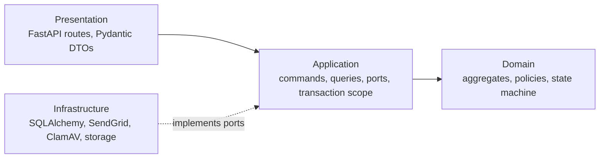
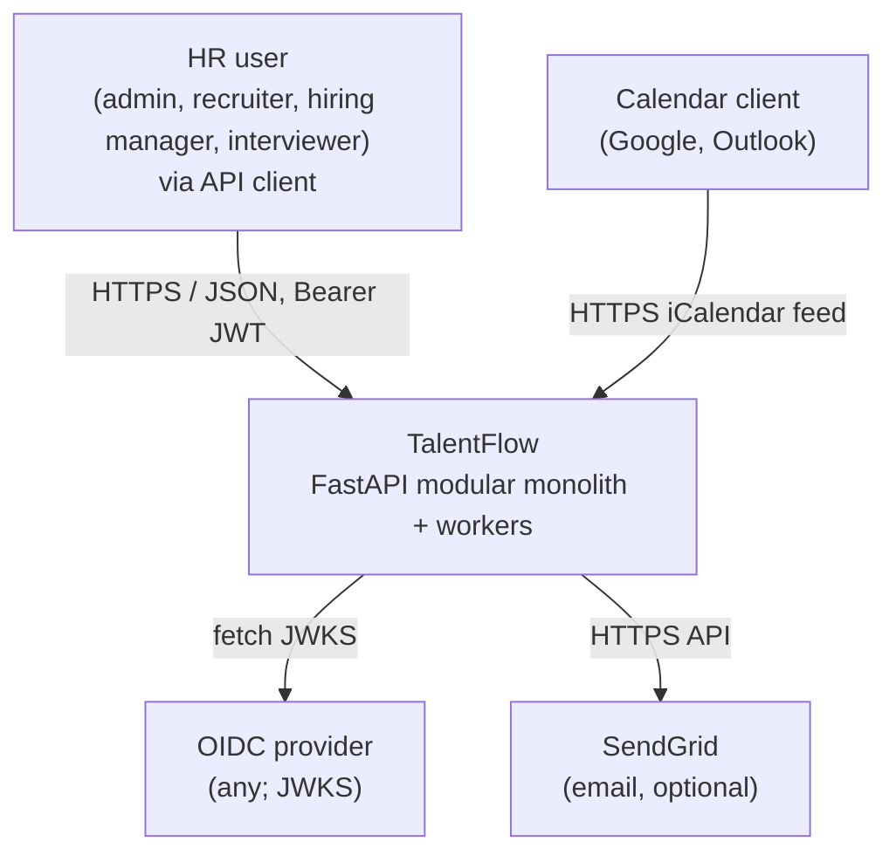
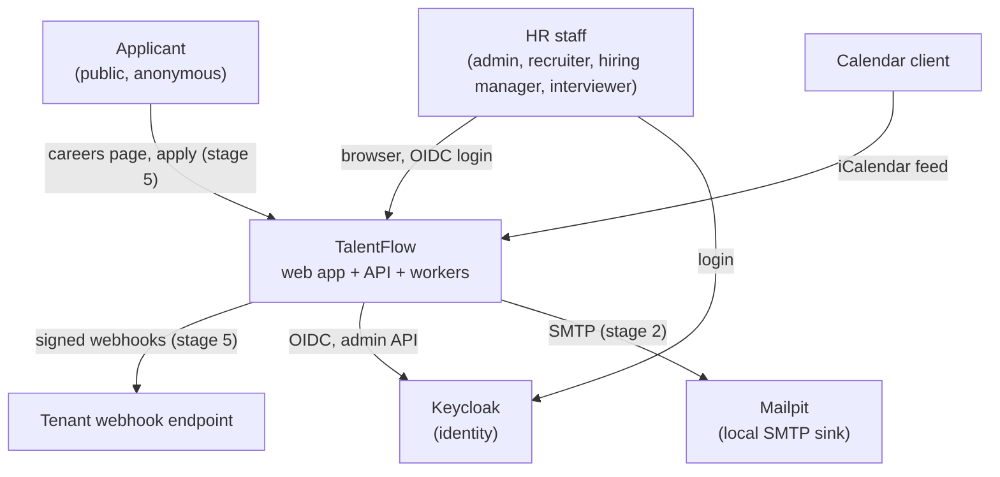
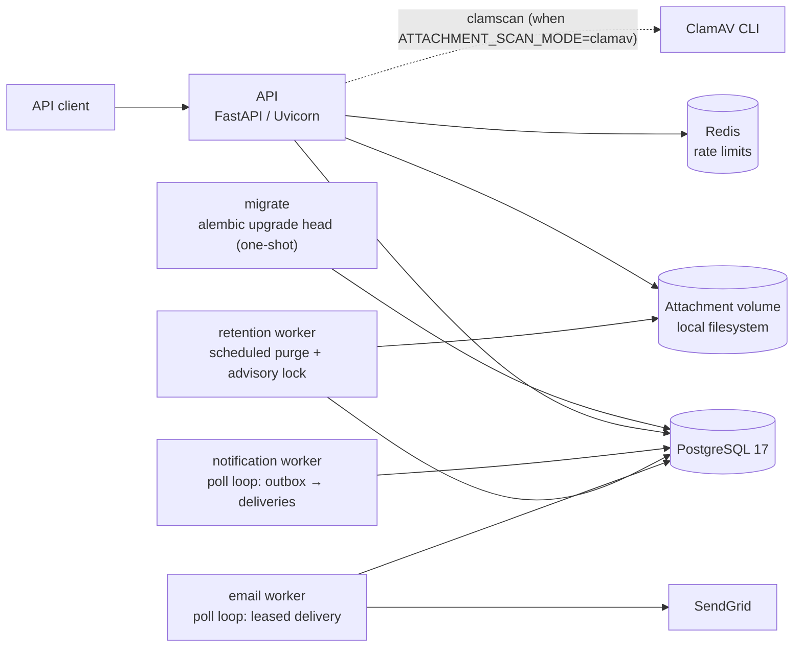
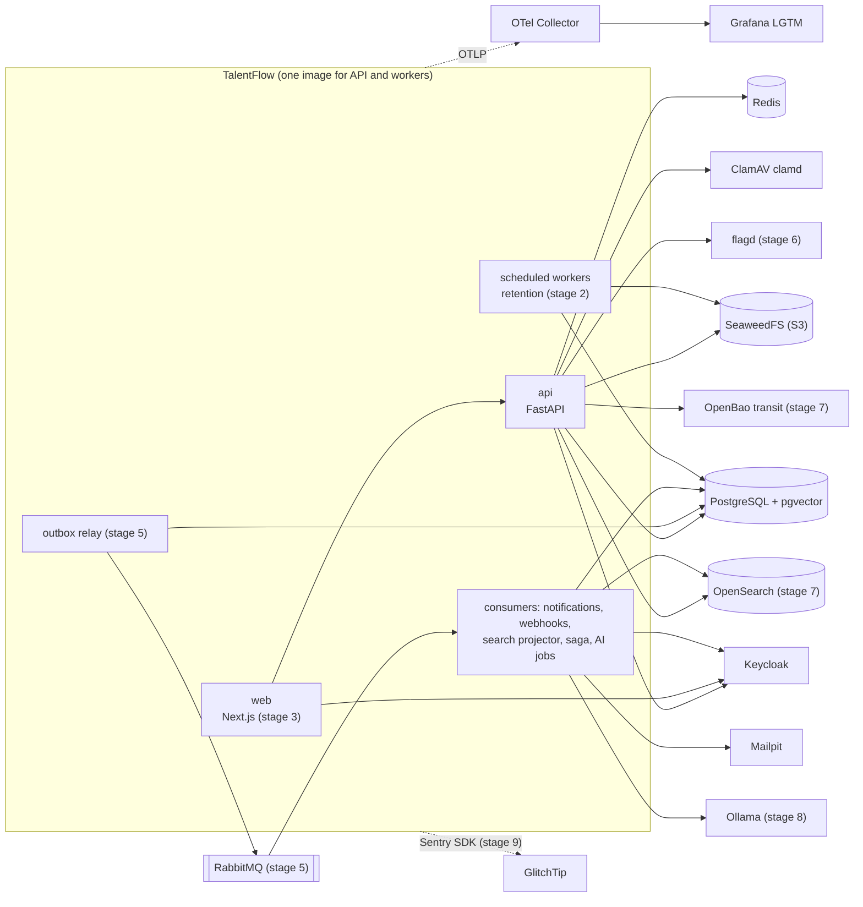
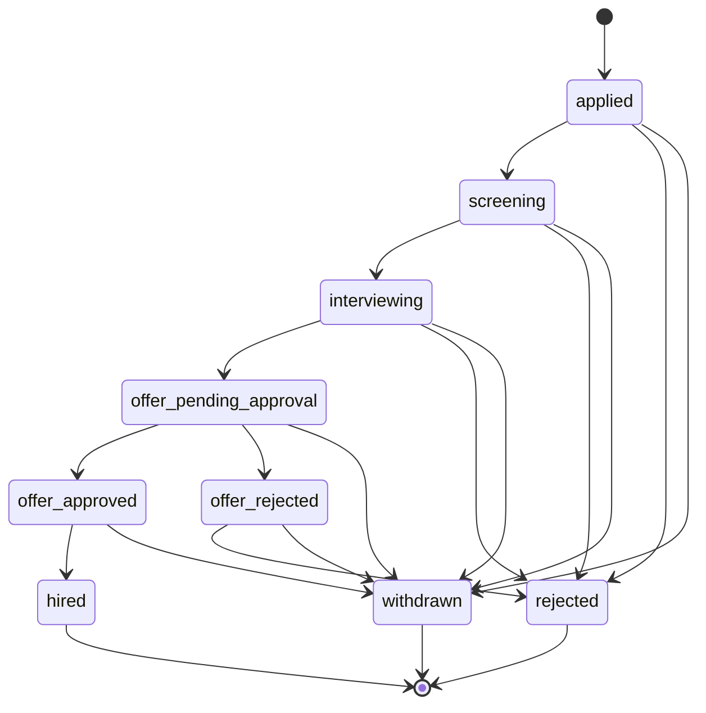
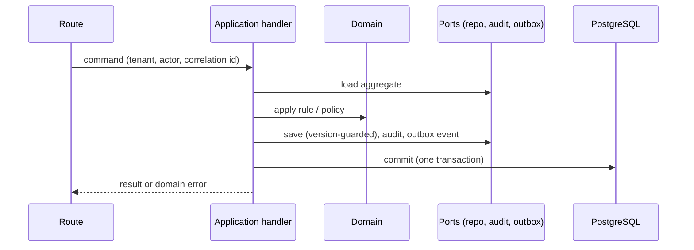
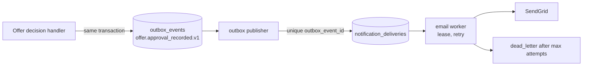
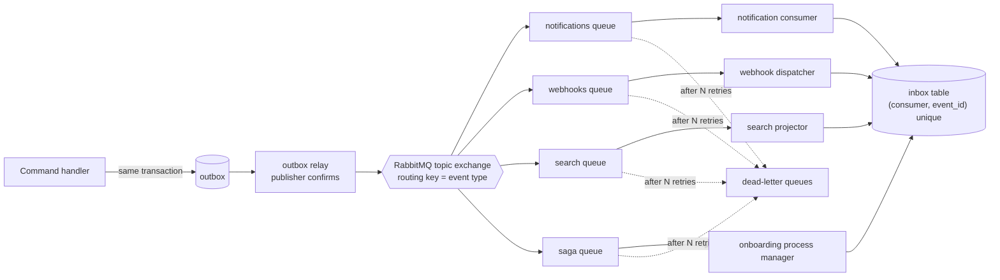
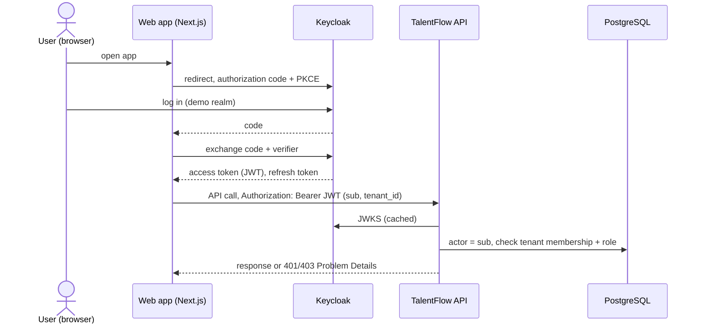

# TalentFlow architecture

This document describes the architecture **as built today** (baseline commit `db1f7bc`, 2026-11-24) and the **target** architecture of the [roadmap](roadmap.md). Every target element is labelled with the stage that delivers it. Runtime services are chosen in [ADR 003](adr/003-local-open-source-runtime-stack.md).

## 1. Thesis

TalentFlow is a multi-tenant HR candidate workflow and case-management platform (ATS). It is a **modular monolith**: one deployable API, background workers built from the same image, one PostgreSQL transactional boundary, and bounded contexts with explicit ports. This avoids distributed transactions and cross-service deployment before the domain, ownership or scale proves a split is worth it ([ADR 001](adr/001-modular-monolith-clean-architecture.md)).

Inside each module, Clean/Hexagonal layering applies and dependencies point inward:

| Layer | May contain | Must not depend on |
| --- | --- | --- |
| Domain | aggregates, entities, policies, value objects, domain errors | FastAPI, SQLAlchemy, Pydantic, provider SDKs |
| Application | commands, handlers, query services, ports, unit-of-work contracts | HTTP framework, ORM records (`app.shared.models`), provider SDKs |
| Infrastructure | repositories, persistence records, provider clients, workers | presentation concerns |
| Presentation | routes, DTOs, dependency wiring, error mapping | business invariants |

`tests/architecture/test_dependency_rule.py` enforces the domain rule for every module and the application rule for `attachments`, `audit`, `calendar`, `candidates`, `interviews`, `offers`, `organization`, `reporting` and `retention`. It also forbids direct cross-module infrastructure imports and requires each cross-context persistence import to be a documented allow-list entry.

## 2. System context (C4 level 1)

### Current

There is no web UI yet. Authentication is either `oidc_jwt` (production mode) or `development_headers` (`X-Tenant-Id` / `X-Actor-Id`, development and tests only).

### Target

## 3. Containers (C4 level 2)

### Current

Workers are long-lived processes built from the API image. They poll with bounded exponential backoff, drain on SIGTERM (releasing email leases if the grace period expires), expose `/health/live`, `/health/ready` and `/metrics`, and record cycle-success and backlog metrics. Retention uses a configurable interval and PostgreSQL advisory lock, so only one replica purges at a time. `docker compose --profile workers up -d` starts the notification and retention services.

### Target

## 4. Bounded contexts

| Context | Responsibility | Status | Key patterns |
| --- | --- | --- | --- |
| Organization | tenants, memberships, requisitions | implemented | application service, unit of work, audit |
| Identity | JWT validation, actor context, RBAC permissions | implemented | ports/adapters, JWKS rotation |
| Candidates | case creation, list/filter, lifecycle transitions | implemented | aggregate, state machine (`workflow`), optimistic locking, CQRS-lite |
| Interviews | scheduling, scoped interview listing, structured feedback | implemented | authorization policy, application-layer ownership rule, opaque `(scheduled_at, id)` keyset read model, one-feedback-per-interview |
| Offers | staged approvals | implemented | aggregate, policy object, immutable decisions, outbox |
| Notifications | outbox materialization, email delivery | implemented | outbox, leased worker, retry, dead letter |
| Audit | tenant-scoped append-only evidence | implemented | same-transaction audit write; hash chain planned (stage 7) |
| Audit read side | case-scoped timeline | implemented | keyset pagination; metadata is projected through a default-deny PII allowlist |
| Attachments | upload, scan, private storage, download | implemented (filesystem) | file-signature checks, malware-scan port; S3 + presigned URLs planned (stage 2) |
| Calendar | revocable iCalendar feeds | implemented | capability URL, hashed tokens, expiry |
| Reporting | PII-free pipeline read model | implemented | read model |
| Retention | retention policy, legal hold, purge | implemented | bounded purge worker, anonymization |
| Search | candidate full-text search and facets | **planned — stage 7** | event-fed OpenSearch projection, alias swap rebuild |
| Webhooks | tenant subscriptions, signed delivery | **planned — stage 5** | HMAC signing, retry/DLQ, SSRF guard |
| Onboarding saga | hire → employee record, account, day-1 tasks | **planned — stage 6** | process manager, compensation |
| Feature flags | per-tenant/role targeting, kill switches | **planned — stage 6** | OpenFeature, flagd |
| AI assistant | resume parsing, matching, feedback summary | **planned — stage 8** | LLM gateway port, guardrails, eval harness, pgvector |

Known gaps in today's boundaries (fixed by DUTH-45 in stage 2): tenant, candidate, interview and offer routes still live in `app/main.py`, other routers in `app/api/`, and all ORM records are shared in `app/shared/models.py`.

## 5. Candidate workflow and concurrency

Transitions are defined in `app/modules/workflow/domain/candidate_state_machine.py`. Every write carries `expected_version`; the repository issues a version-guarded `UPDATE` and a `rowcount` of 0 becomes a 409 conflict instead of a lost update. Stage 5 adds `ETag`/`If-Match` as an HTTP-native alternative.

Offer approval is ordered by `ApprovalPolicy.standard()`: hiring manager, then tenant admin. The same policy drives the read-side `awaiting_role` and `can_decide` fields, so the approval inbox displays exactly the actions the write path permits. A rejection at either step moves the candidate to `offer_rejected`.

## 6. Command flow and transaction ownership

The application handler owns the transaction, so a state change, its audit record and its outbox event commit together or not at all.

## 7. Event flow

### Current: outbox → notification deliveries

Delivery is **at-least-once**. Idempotency comes from the unique `notification_deliveries.outbox_event_id`; a crashed worker's expired lease is reclaimed and only the lease holder can finalize ([ADR 002](adr/002-transactional-outbox.md)).

### Target: outbox → RabbitMQ → consumers with inbox dedup (stage 5)

Each consumer records `(consumer, event_id)` in an inbox table in the same transaction as its side effect, so a redelivered event is applied once. The envelope, event catalog and topology are defined in [ADR 006](adr/006-integration-event-contract.md) and [`docs/events/asyncapi.yaml`](events/asyncapi.yaml). Payloads carry identifiers, not free-text PII.

## 8. Identity and tenancy

### Current

- `AUTH_MODE=oidc_jwt`: the API validates signature, issuer, audience and expiry against the configured JWKS (`app/modules/identity/infrastructure/jwt_validator.py`), refreshing keys once on an unknown `kid`. The token must carry `sub` and a `tenant_id` claim; `sub` is used as the local actor id, then tenant membership and role permissions are checked (`app/modules/identity/security.py`).
- `AUTH_MODE=development_headers`: `X-Tenant-Id` and `X-Actor-Id`, rejected by settings validation in production.
- Every aggregate lookup and write is tenant-scoped in the application; Row-Level Security adds a database-level guard in stage 7.

<!-- permission-matrix:start -->
| Permission | `tenant_admin` | `recruiter` | `auditor` | `hiring_manager` | `interviewer` |
| --- | --- | --- | --- | --- | --- |
| `requisition:create` | ✓ | ✓ |  |  |  |
| `candidate:create` | ✓ | ✓ |  |  |  |
| `candidate:transition` | ✓ | ✓ |  |  |  |
| `candidate:attachment` | ✓ | ✓ |  |  |  |
| `calendar:manage` | ✓ | ✓ |  |  |  |
| `calendar:self` |  |  |  |  | ✓ |
| `interview:manage` | ✓ | ✓ |  |  |  |
| `feedback:submit` |  |  |  |  | ✓ |
| `audit:read` | ✓ | ✓ | ✓ |  |  |
| `report:read` | ✓ | ✓ |  |  |  |
| `tenant:read` | ✓ | ✓ | ✓ | ✓ |  |
| `retention:manage` | ✓ | ✓ |  |  |  |
| `retention:purge` | ✓ | ✓ |  |  |  |
<!-- permission-matrix:end -->

`calendar:self` is scoped to the caller: it permits an interviewer to manage only links whose interviewer is their own authenticated identity, while `calendar:manage` remains the tenant-wide administrative permission.

### Target: login through Keycloak (stages 2–3)

Keycloak owns authentication; TalentFlow owns authorization (tenant membership and role permissions stay in the app database). Because the API uses `sub` as the actor id and requires a `tenant_id` claim, the Keycloak realm needs a `tenant_id` protocol mapper and the seed step (DUTH-50) must create each demo user with the same id in Keycloak and the app database. The onboarding saga (stage 6) uses the Keycloak admin API to provision accounts.

The local realm's `tenant_id` mapper is hardcoded only for its single demo tenant; a multi-tenant realm must derive the claim from a user attribute or tenant mapping.

## 9. Persistence

- SQLAlchemy ORM records are persistence models, not domain objects; repositories translate between them.
- A context owns mapped records in `app/modules/<context>/infrastructure/models.py`. Its `persistence.py` publishes only the records that an explicitly allow-listed cross-context dependency needs. The allow-list covers transactional audit writes, identity membership lookup, ownership validation, notification recipient/outbox handling, retention purge, and Reporting's CQRS-lite projection; all other cross-context access uses an application port or an integration event.
- PostgreSQL is the system of record; tests run on SQLite, CI also applies migrations to PostgreSQL.
- The audit timeline uses a `CaseTimelineReader` application port. Its SQLAlchemy adapter has read-only access to candidate existence and attachment ids, with tenant predicates on both the audit rows and attachment subquery. The application handler decodes cursors, assembles pages and applies the metadata allowlist; routers map permissions, errors and response models. Candidate detail and retention reads likewise go through their module repository ports.
- Schema changes go through Alembic (`migrations/versions/`) with expand/contract compatibility. The app creates tables only outside production.
- Database constraints back the invariants: tenant-unique candidate email, one feedback per interview, one decision per approval step, unique outbox materialization.

## 10. Operations (local)

- Probes: `/health/live`, `/health/ready` (database), `/metrics` (Prometheus: HTTP RED, conflicts, outbox backlog, delivery outcomes, dead letters, worker claims).
- Logs: JSON with `correlation_id`. Tracing: FastAPI OpenTelemetry instrumentation propagates trace context; an OTLP exporter, the Collector and Grafana arrive in stage 2 (DUTH-92, after the core compose stack).
- Backups: [backup and restore runbook](runbooks/backup-restore.md).
- Configuration is validated at startup (`app/shared/settings.py`); secrets are typed and redacted. Local credentials are dev-only values in `.env.example`.

## 11. Quality controls

- `ruff format --check`, `ruff check`, `python -m pytest` with coverage ≥ 85%, architecture tests.
- CI (`.github/workflows/ci.yml`): migrations on PostgreSQL, tests, image build, API readiness, worker smoke command. Security (`.github/workflows/security.yml`): CodeQL, Trivy dependency and image scan.
- Last local run (2026-11-24, `uv run python -m pytest`): **63 passed, 87.94% coverage**.

## 12. Service extraction criteria

A module becomes a separate service only with evidence of: materially different scaling or availability needs; an independent release cadence or owning team; a hard security boundary; stable contracts with low cross-context transaction coupling; or better operational economics than in-process integration. Likely order if justified: Notifications, then read projections (Reporting, Search), then AI jobs. Stage 5's RabbitMQ events create the seam; they do not by themselves justify a split.
