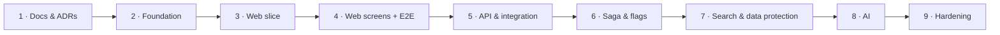

# Roadmap: TalentFlow v2 enterprise showcase

This roadmap tracks DUTH-43: turn TalentFlow into a complete, runnable showcase where `docker compose up` brings up the API, workers, web app and a fully open-source supporting stack ([ADR 005](adr/005-local-open-source-runtime-stack.md)), and every pattern is backed by code, tests and docs.

Ground rules:

- Stages run in order; a stage starts only after the previous one is delivered.
- Issues marked **spec first** go through `spec → spec_review → plan` before code.
- Each new pattern ships with tests and a short doc or ADR, and its row in the [README pattern catalog](../README.md#pattern-catalog) moves from `planned` to `implemented` in the same PR.

## Stage 1 — Docs and ADRs rewritten for the plan

**Outcome:** README, architecture, roadmap and ADRs describe the local open-source plan; the old AWS-track docs are removed.

| Issue | Deliverable |
| --- | --- |
| DUTH-44 | README with pattern catalog, architecture (current + target), this roadmap, ADR 005, removal of AWS-track docs, compose backup/restore runbook |

**Teaches:** architecture decision records, C4 diagrams, docs-as-code.

## Stage 2 — Foundation

**Outcome:** real module boundaries, one error model, long-running workers, and `docker compose up -d && make seed` gives a healthy stack with Keycloak login and telemetry in Grafana.

| Issue | Deliverable |
| --- | --- |
| DUTH-45 | Routes and ORM records moved into their modules; architecture test forbids cross-module infrastructure imports |
| DUTH-46 | RFC 9457 Problem Details for every error; `docs/api-errors.md` |
| DUTH-47 | Long-running workers: poll loop with backoff, SIGTERM drain, scheduled retention with an advisory lock, worker health and metrics |
| DUTH-48 | SMTP email adapter to Mailpit; SendGrid stays optional |
| DUTH-49 | S3 attachment storage (SeaweedFS) with presigned downloads after authorization and audit |
| DUTH-50 | One-command compose stack: Postgres+pgvector, Redis, Keycloak realm import, Mailpit, ClamAV, SeaweedFS, OTel Collector + Grafana LGTM, API, workers, seed data, compose smoke job in CI |

**Teaches:** modular-monolith boundaries enforced by tests, standard error contracts, graceful shutdown, singleton scheduling with advisory locks, ports and adapters for email and storage, presigned URLs, OIDC with a real IdP, OpenTelemetry pipeline and RED dashboards.

## Stage 3 — Web app vertical slice

**Outcome:** a Next.js + TypeScript + shadcn/ui app where demo users log in through Keycloak and move candidates on a pipeline board.

| Issue | Deliverable |
| --- | --- |
| DUTH-51 | `web/` shell: authorization code + PKCE login, session, tenant context, role-aware nav, OpenAPI-generated client checked in CI |
| DUTH-52 | Pipeline board with stage transitions, `expected_version` and a conflict prompt on 409 |

**Teaches:** OIDC in a browser app, contract-first typed clients, optimistic concurrency in the UI.

## Stage 4 — Web app: remaining hiring screens and E2E

**Outcome:** the full hiring flow works in the browser and is covered by an E2E test on every PR.

| Issue | Deliverable |
| --- | --- |
| DUTH-53 | Candidate detail with attachments and audit timeline; legal-hold and retention status for admins |
| DUTH-54 | Interview scheduling, interviewer feedback, calendar subscription link |
| DUTH-55 | Offer creation and two-step approval inbox |
| DUTH-56 | Pipeline reporting dashboard (no PII) |
| DUTH-57 | Playwright E2E happy path plus a stale-version negative scenario, against the compose stack |

**Teaches:** permission-aware UI, end-to-end testing against real infrastructure, testing failure paths.

## Stage 5 — API and integration patterns

**Outcome:** domain events flow through RabbitMQ with at-least-once delivery and idempotent consumers; the API supports safe retries and conditional updates; tenants get webhooks and a public careers page.

| Issue | Deliverable |
| --- | --- |
| DUTH-58 | Versioned event envelope, event catalog, RabbitMQ topology; `docs/events/asyncapi.yaml` + ADR |
| DUTH-59 | Outbox relay to RabbitMQ with publisher confirms; consumer inbox dedup; retry and DLQ |
| DUTH-60 | `Idempotency-Key` on command endpoints |
| DUTH-61 | `ETag` / `If-Match` with 412 and 428 |
| DUTH-62 | Outbound webhooks: HMAC-SHA256 signatures, retries, delivery log, SSRF protection |
| DUTH-63 | Public careers page and self-apply with abuse controls and consent capture |

**Teaches:** event-driven integration, schema evolution, inbox pattern, idempotency keys, HTTP conditional requests, signed webhooks, SSRF defence, handling untrusted public input.

## Stage 6 — Saga and feature flags

**Outcome:** hiring a candidate triggers an observable onboarding process with compensation; features can be toggled per tenant without a redeploy.

| Issue | Deliverable |
| --- | --- |
| DUTH-64 | **Spec first.** Hire-to-onboarding saga (process manager) with timeouts, retries and compensation; ADR on orchestration vs choreography and in-house vs Temporal |
| DUTH-65 | OpenFeature in API and web app with flagd; per-tenant and per-role targeting; kill switch; flag lifecycle doc |

**Teaches:** sagas and compensating actions, process state persistence, feature-flag lifecycle and safe defaults.

## Stage 7 — Search and data protection

**Outcome:** tenant-isolated full-text search, database-enforced tenant isolation, encrypted PII with crypto-shredding, DSAR export, and a tamper-evident audit log.

| Issue | Deliverable |
| --- | --- |
| DUTH-66 | OpenSearch read projection fed by events; zero-downtime rebuild via alias swap; lag metric |
| DUTH-67 | PostgreSQL Row-Level Security behind the application predicates |
| DUTH-68 | **Spec first.** Per-tenant envelope encryption of PII via OpenBao transit; blind index; crypto-shredding |
| DUTH-69 | Candidate data export (DSAR), async with an expiring link |
| DUTH-70 | Hash-chained audit log with a `verify` command |

**Teaches:** CQRS read models, defence in depth, envelope encryption and key rotation, privacy rights, tamper evidence.

## Stage 8 — AI

**Outcome:** AI assists recruiters through one guarded gateway; it never decides for them.

| Issue | Deliverable |
| --- | --- |
| DUTH-71 | **Spec first.** `LlmPort` + Ollama adapter: PII redaction, versioned prompts, budgets, async via RabbitMQ, audit, offline eval harness; ADR on human-in-the-loop and fairness |
| DUTH-72 | Resume parsing into a draft profile a recruiter confirms; behind a flag |
| DUTH-73 | Candidate–requisition matching with pgvector; advisory scores; protected attributes excluded |
| DUTH-74 | Interview feedback summary for hiring managers, with citations |

**Teaches:** LLM gateway pattern, guardrails, evaluation in CI, embeddings in PostgreSQL, responsible AI in hiring.

## Stage 9 — Quality and security hardening

**Outcome:** errors are tracked without PII, performance has a baseline, the supply chain is verifiable, and the whole stack has a threat model and audit.

| Issue | Deliverable |
| --- | --- |
| DUTH-75 | GlitchTip error tracking via the Sentry SDK with a PII scrubber |
| DUTH-76 | k6 load tests with SLO thresholds and a committed baseline in `docs/performance/` |
| DUTH-77 | SBOM, Cosign keyless image signing, licence policy, Dependabot or Renovate |
| DUTH-78 | STRIDE threat model in `docs/security/threat-model.md` and a security audit |

**Teaches:** privacy-safe error tracking, SLO-driven load testing, software supply-chain security, threat modelling.

## Out of scope

- Cloud provisioning and the AWS/OpenTofu track. `infra/opentofu/` and the `Infrastructure` workflow are not maintained and stay in place until a separate issue removes them.
- Splitting the monolith into services. The extraction criteria in [architecture](architecture.md#service-extraction-criteria) still apply.
