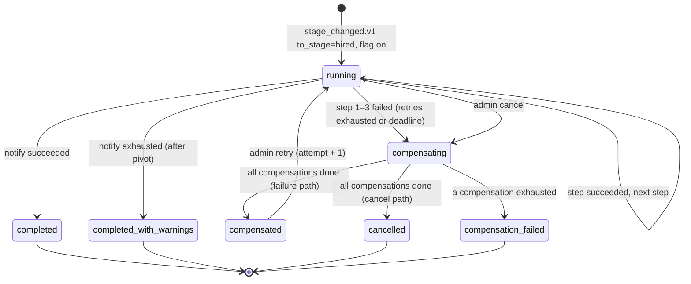

# DUTH-64: Hire-to-onboarding saga with compensation

## Context and problem

Hiring ends the recruiting workflow today. `TransitionCandidateHandler` (`app/modules/candidates/application/transition_candidate.py`) moves a case from `offer_approved` to `hired` only when an approved offer exists, and `hired` is terminal (`app/modules/workflow/domain/candidate_state_machine.py`). Nothing happens after that. Stage 6 of DUTH-43 adds onboarding. It is the repo's first long-running, multi-step business process that calls external systems, so it is the showcase for process managers, timeouts, retries and compensating actions (`docs/roadmap.md`, stage 6).

State of `main` at `e201ca6`:

- The transition writes `candidate_case.stage_changed.v1` to the transactional outbox. The relay publishes it to the `talentflow.events` topic exchange (ADR 002, ADR 006, `docs/events/operations.md`). Delivery is at least once and unordered. Consumers deduplicate on `(consumer, id)` in `inbox_messages` within the transaction that does their side effect.
- The AsyncAPI catalog (`docs/events/asyncapi.yaml`) already reserves the queue `onboarding.events` for this issue. Its binding keys are `candidate_case.stage_changed.v1` and `candidate_case.erased.v1`, and the process manager starts on `to_stage = hired`. `candidate_case.erased.v1` is `reserved`: DUTH-69 (DSAR) will publish it.
- Consumers already have retry routes (10 s, 60 s, 600 s), a DLQ, poison handling and the `talentflow_consumer_messages_total` metric. Those are implemented for notifications through `app/shared/rabbitmq.py`.
- Feature flags (ADR 010, DUTH-65) are on `main`. Flags are named `<kind>.<module>.<capability>` with kind `release` or `ops`, take a tenant-scoped context, fall back to `false`, and are exposed to the web as public feature names in `GET /v1/me` `features`.
- Keycloak 26 runs in Compose with the `talentflow` realm imported from `keycloak/realm-talentflow.json`. The app uses it only for login.
- Email goes through the notifications delivery worker to Mailpit (DUTH-48).
- Requisitions have no hiring-manager field: only `created_by` (`app/modules/organization/infrastructure/models.py`).
- `APP_ENV` is `development`, `test` or `production` (`app/shared/settings.py`).

## Decisions from the requester (duthaho, on this issue, 2026-11-28)

The six proposed defaults were accepted. Two are adjusted to match `main`. Both adjustments are marked **(adjusted)**.

1. The account is created in a separate Keycloak realm, `employees`, that stands in for the company directory. A confidential client holds only `manage-users` on that realm. The user is created disabled and has no credentials.
2. Steps 1–3 (employee record, account, day-1 tasks) are compensable. Once they succeed, the saga has passed its pivot. Notify only retries; when its retries run out, the saga ends `completed_with_warnings` and nothing is rolled back.
3. **(adjusted)** One internal email goes through Mailpit. The candidate gets nothing. Requisitions have no hiring manager, so the recipients are the user who performed the hire and the requisition's `created_by`, deduplicated, provided each still has a membership in the tenant.
4. Day-1 tasks are a fixed template in code: laptop, accounts, buddy, orientation. They are due on a start date the recruiter enters at hire time. Without a date, they are due 14 days after the hire. They are read-only.
5. The web app shows a read-only saga timeline on the candidate detail page. A tenant admin can **retry** a saga that ended `compensated` and **cancel** a saga that is still `running`. Both actions are audited.
6. **(adjusted)** Failure injection for demos is a setting, not a flag. ADR 010 allows only `release` and `ops` flags, which must be positive (`true` = runs) and fall back to `false`. A fault flag would break both rules, and a flagd outage would then compensate every running saga. Instead, `ONBOARDING_FAULT_INJECTION` lists step names whose adapter call fails. Startup refuses it when `APP_ENV=production`. Changing it needs a worker restart (`docker compose up -d onboarding-worker`).

## Goals

- Hiring a candidate in a tenant with onboarding enabled starts exactly one onboarding saga. The saga creates an employee record, provisions a directory account, schedules day-1 tasks and notifies the hiring team.
- Each step has an attempt timeout, bounded retries and an overall deadline. Each compensable step has an idempotent compensating action. A failure runs compensations in reverse order.
- Saga state lives in PostgreSQL, survives worker restarts and is visible in the web app, in metrics and in the audit trail.
- Duplicate, redelivered or out-of-order events never create a second saga or corrupt a running one.
- The feature is gated per tenant by `release.onboarding.saga`.
- ADR 011 records orchestration vs choreography and the in-house process manager vs Temporal.

## Non-goals

- A real HRIS. The HRIS is a stub HTTP service in Compose.
- Logging in to anything with the provisioned account: no password, no activation email, no enabling the user.
- Undoing the hire. The candidate stays `hired` whatever the saga outcome. A saga failure is an onboarding problem, not a recruiting one.
- Editable task templates, task assignment, completing tasks, or onboarding beyond day 1.
- Any email or portal for the new hire.
- New integration-event types. The saga consumes events but publishes none. A future `onboarding.*` event is a separate issue.
- Temporal or any other workflow engine. ADR 011 explains why.
- Deleting the employee record or the directory account when a completed onboarding's candidate is erased. See Risks R4.
- Exposing onboarding through outbound webhooks or search.

## Users and use cases

| Actor | Permission | Use case |
|---|---|---|
| Recruiter / tenant admin | `candidate:transition` | Hires a candidate, optionally with a start date. Watches the onboarding panel move through its steps. |
| Hiring team (hire actor, requisition creator) | — | Receives one "onboarding ready" email with the candidate's name, the start date and the task list. |
| Tenant admin | `onboarding:manage` (new, `tenant_admin` only) | Retries a compensated saga. Cancels a running one, for example when the hire was entered by mistake. |
| Any tenant member | `tenant:read` | Sees the onboarding timeline on the candidate detail page. |
| Operator | Compose host | Watches the metrics and dashboard, reads the runbook, toggles the release flag, injects faults locally. |

## Process



| # | Step | Action | Compensation | Attempt timeout | Retries (backoff) | Step deadline |
|---|---|---|---|---|---|---|
| 1 | `create_employee` | `PUT` the employee on the HRIS stub, keyed by saga id | `DELETE` the employee (a 404 counts as success) | 5 s | 4 (10 s, 30 s, 2 min, 5 min) | 15 min |
| 2 | `provision_account` | Create a disabled user in realm `employees`. Username `tf-<candidate_case_id>`; a 409 adopts the existing user if it carries this saga's attribute | Delete the user (a 404 counts as success) | 5 s | 4 (same) | 15 min |
| 3 | `schedule_tasks` | Insert the four template tasks, due on the start date | Mark the saga's tasks `cancelled` | — (local DB) | 2 (10 s, 30 s) | 5 min |
| 4 | `notify` | Write one notification delivery for the recipients (decision 3) | none (after the pivot) | — (local DB) | 4 (same as 1) | 30 min |

Rules:

- **Orchestration.** The `onboarding` module owns the process manager. It decides every next step from persisted state. The external systems never call back.
- **Timers.** Each step row has `next_attempt_at`. The worker claims due rows with `FOR UPDATE SKIP LOCKED`. A crash or a restart loses nothing; a due row is claimed again.
- **Attempt.** One attempt = one external call inside its timeout. Its outcome is written in the same transaction that schedules the next attempt, the next step, or compensation. A timeout counts as a failure. Retries use the table's backoff. When the retries run out or the step deadline passes, the step is `failed`.
- **Idempotent effects.** Each external call carries a key derived from `(saga_id, step)`. The HRIS stub upserts on it. The Keycloak adapter uses a deterministic username plus an `onboarding_saga_id` user attribute. A retry after an ambiguous timeout therefore creates nothing twice.
- **Compensation.** Only completed steps are compensated, in reverse order. Compensations retry with the same backoff and no deadline (up to 6 attempts). If one runs out, the saga ends `compensation_failed`: the metric fires, the panel shows the step, and the runbook covers manual cleanup.
- **Cancel.** It waits for the in-flight attempt to finish, then compensates whatever has completed. It is refused once the saga has passed the pivot.
- **Retry.** It starts a new attempt number from step 1. Earlier attempts stay in the history.
- **Personal data.** Saga tables store ids, external references, statuses, timestamps and error class names only. Each step reads the candidate's name and email through a candidates-module port at execution time. The step passes them to the HRIS or Keycloak and does not persist them.

## Contract

### Hire with a start date

`PATCH /v1/candidate-cases/{id}/stage` (existing) gains an optional `start_date` (`YYYY-MM-DD`). It is accepted only with `target_stage = hired`; otherwise the request fails with `422 validation-error`. The schema field is `TransitionCandidateCaseRequest.start_date`. The date must fall between today and today + 365 days. It is stored in a new nullable column, `candidate_cases.hire_start_date` (expand-only migration), and returned on the case response. The event payload does not change: the saga reads the date through the candidates port.

### Read

`GET /v1/candidate-cases/{id}/onboarding` — `tenant:read`. `404 not-found` when the case has no saga or belongs to another tenant.

```json
{
  "id": "…", "candidate_case_id": "…", "status": "running", "attempt": 1, "version": 7,
  "start_date": "2026-12-14", "started_at": "…", "finished_at": null,
  "steps": [
    { "step": "create_employee", "status": "succeeded", "attempts": 1, "last_error": null,
      "next_attempt_at": null, "completed_at": "…", "compensation_status": null }
  ],
  "tasks": [ { "key": "laptop", "title": "Prepare laptop", "due_date": "2026-12-14", "status": "scheduled" } ],
  "actions": { "can_retry": false, "can_cancel": true }
}
```

`last_error` is an error class name, never a message or a response body. The response carries `ETag: "<version>"`.

### Act

`POST /v1/onboarding-sagas/{id}/retry` and `POST /v1/onboarding-sagas/{id}/cancel` — `onboarding:manage`. Both require `If-Match` (ADR 007) and support `Idempotency-Key` (ADR 005).

- `202 Accepted` returns the saga body.
- `409 conflict` when the state does not allow the action: retry is allowed only from `compensated`, cancel only from `running` before the pivot.
- `412 precondition-failed` when `If-Match` is stale, and `428 precondition-required` when it is missing.
- Each action writes an audit entry (`onboarding.retry_requested` or `onboarding.cancel_requested`) with the actor and the correlation id.

### Feature gate

- Flag `release.onboarding.saga`: boolean, `tenant` scope, fallback `false`, default variant `off`, with targeting for the demo tenant and the required metadata and `expiresAt`. It goes in the registry and passes the ADR 010 flag-file lint.
- Public feature name `onboarding`, returned in `GET /v1/me` `features`.
- The consumer evaluates the flag **once, when the saga would start**. When the flag is off, or flagd is down, no saga is created. The inbox still records the event, and the outcome is counted as `skipped_flag_off`.
- A saga that has started keeps running when the flag is later turned off. Stopping half-way would strand provisioned accounts; that is worse than finishing.
- With the gate off, the retry and cancel endpoints return `403 feature-disabled` (ADR 010 §3). `GET` keeps working, so the history stays readable.
- The web hides the panel when `features.onboarding` is false and the case has no saga.

### Events consumed (queue `onboarding.events`, consumer name `onboarding`)

| Event | Handling, all in one transaction with the inbox insert |
|---|---|
| `candidate_case.stage_changed.v1`, `to_stage = hired` | Evaluate the flag. Insert a saga and its step rows, unless a saga for `(tenant_id, candidate_case_id)` already exists (unique constraint) or an erasure tombstone exists. |
| `candidate_case.stage_changed.v1`, any other `to_stage` | Inbox insert only (`skipped`). |
| `candidate_case.erased.v1` | If the saga is running before the pivot, cancel it (compensate). If no saga exists, write a tombstone so that a late `hired` event cannot start one. A finished saga is left as it is (it holds no personal data). |

### Configuration (names only)

- `KEYCLOAK_ADMIN_URL`
- `KEYCLOAK_ONBOARDING_REALM` (`employees`)
- `KEYCLOAK_ONBOARDING_CLIENT_ID`
- `KEYCLOAK_ONBOARDING_CLIENT_SECRET` (secret; the Compose dev value is public and documented as such)
- `HRIS_STUB_URL`
- `ONBOARDING_FAULT_INJECTION` (comma-separated step names; empty by default; refused in production)
- the existing `WORKER_*` settings

### Runtime

- A new Compose service, `onboarding-worker`, consumes the queue and runs the timer loop. Health and metrics follow the existing worker pattern.
- A new Compose service, `hris-stub`, is a small HTTP app with an in-memory store, on the default network only and with no published ports.
- `keycloak/realm-employees.json` is imported next to the `talentflow` realm.
- Metrics:
  - `talentflow_onboarding_sagas_total{status}`
  - `talentflow_onboarding_step_attempts_total{step,outcome}`
  - `talentflow_onboarding_running` (gauge)
  - the existing consumer outcomes
- One Grafana panel row on the messaging dashboard.

## Acceptance criteria

Traced to the issue's AC1–AC4.

- **AC1 (happy path, issue AC1):** Given a tenant with `release.onboarding.saga` on, when a recruiter hires a candidate with a start date through the API or the web app, then within 30 s in the running Compose stack:
  - the HRIS stub holds the employee;
  - realm `employees` holds a disabled user `tf-<candidate_case_id>`;
  - the four tasks exist, due on the start date;
  - Mailpit has one email to the deduplicated recipients;
  - the saga is `completed`;
  - the candidate detail page shows each step as succeeded.

  A Playwright E2E test and an integration test against a real broker cover this.
- **AC2 (start date default):** Given no start date, when the candidate is hired, then the tasks are due 14 days after the hire. Given `start_date` with a target stage other than `hired`, the API returns `422`.
- **AC3 (compensation per step, issue AC2):** Given a fault injected at `create_employee`, `provision_account` or `schedule_tasks`, when the saga runs, then the step retries on its schedule and fails, then every completed step is compensated in reverse order, and the saga ends `compensated`. Three tests, one per step, assert the exact order of compensation calls and the final external state (nothing left in the HRIS or Keycloak).
- **AC4 (pivot):** Given a fault at `notify`, when its retries run out, then nothing is compensated and the saga ends `completed_with_warnings`. A test covers this.
- **AC5 (timeouts):** Given an adapter that does not answer within the attempt timeout, the attempt counts as failed and is retried. Given a step that keeps failing until its deadline, the saga compensates. Tests use a controllable clock, not sleeps.
- **AC6 (crash safety):** Given a worker killed between an external call and its commit, when the worker restarts, then the step is attempted again, and the idempotency key prevents a second employee or account. A test covers this for steps 1 and 2.
- **AC7 (compensation failure):** Given a compensation that keeps failing, the saga ends `compensation_failed`, the metric increments, and the panel names the step. A test covers this.
- **AC8 (duplicates and ordering, issue AC3):** Tests cover each of these:
  - the same `hired` event delivered twice creates one saga;
  - two different events for the same hire (for example a replayed outbox row with a new id) create one saga, because of the unique constraint;
  - `erased` before `hired` leaves a tombstone and no saga;
  - `erased` during a running saga compensates it;
  - two worker instances claiming the same due step perform one attempt (row lock plus the saga `version` check).
- **AC9 (gate):** Given the flag off or flagd unreachable, a hire creates no saga, and the consumer counts `skipped_flag_off`. Given a running saga, turning the flag off does not stop it. With the gate off, retry and cancel return `403 feature-disabled`. The panel is hidden in the web app when the feature is off and no saga exists.
- **AC10 (admin actions):** A tenant admin can retry a `compensated` saga (a new attempt starts from step 1) and cancel a running saga before the pivot. Any other state returns `409`. A recruiter gets `403 forbidden`. A stale `If-Match` returns `412`. Each action is audited. Tests cover each case.
- **AC11 (privacy and isolation):**
  - Saga, step and task rows and API responses contain no name or email.
  - `last_error` is a class name.
  - A tenant cannot read or act on another tenant's saga (`404`).

  Tests cover each point.
- **AC12 (security of provisioning):**
  - The onboarding Keycloak client can manage users only in realm `employees`. A test against the real Keycloak shows it gets `403` on realm `talentflow`.
  - The secret is read from settings and excluded from their representation.
  - `ONBOARDING_FAULT_INJECTION` makes startup fail when `APP_ENV=production`.
- **AC13 (docs, issue AC4):**
  - ADR 011 compares orchestration with choreography and the in-house process manager with Temporal, using the forces in this spec.
  - `docs/onboarding.md` covers operations: states, metrics, fault injection, and manual cleanup after `compensation_failed`.
  - The README catalog row becomes `implemented` with links to code, tests and the ADR.
  - `docs/architecture.md` and the AsyncAPI consumer description match the code.
- **AC14 (quality gates):** `ruff format --check`, `ruff check`, `uv run python -m pytest` (coverage ≥ 85 %), the architecture tests (domain and application stay framework-free), the web lint, typecheck and build, and the E2E suite all pass.

## Constraints

- Clean/Hexagonal boundaries:
  - The process manager's state machine and step policy live in `app/modules/onboarding/domain`.
  - The HRIS, Keycloak, clock, candidates and notification ports are in `application`.
  - pika, httpx and SQLAlchemy stay in `infrastructure`.
- Schema changes go through Alembic, expand-only: new `onboarding_*` tables and the nullable `candidate_cases.hire_start_date`.
- The consumer uses the shared RabbitMQ transport, retry and DLQ, and the inbox. No second messaging path.
- No change to the event envelope or to any published event schema.
- flagd usage follows ADR 010 in full: registry, lint, tenant-only context, fallback `false`.
- The Keycloak admin credential never reaches the API process. Only `onboarding-worker` gets it.

## Risks

- **R1. Ambiguous external outcomes.** A timeout after the HRIS or Keycloak acted. Mitigated by idempotency keys, adopt-on-409, and compensations that treat a 404 as success (AC6).
- **R2. Clock-driven tests turning flaky.** Mitigated by an injected clock and by driving the timer loop step by step in tests. Only the E2E test uses real time.
- **R3. Scope size.** Worker, two adapters, a stub service, a realm, an API, a web panel and an ADR. The plan step splits this into stages that each merge on their own (for example process manager and API first, then the web panel and E2E).
- **R4. Erasure after completion.** The directory account and the HRIS employee hold the candidate's name and email. They are left in place because, once hired, those records fall under employment, which is the HRIS's concern, not the ATS's. If the requester or Hoàng-Security disagree, it becomes a follow-up, not a change to this saga.
- **R5. Keycloak admin client scope creep.** A misconfigured client could manage the login realm. AC12 tests the boundary against the real server.

## Open questions

None. The requester answered all six on 2026-11-28. The two adjustments above follow from `main` and are flagged for spec review.

## Rollout and rollback

- **Rollout:**
  - The migration is expand-only.
  - `release.onboarding.saga` ships `off`, with targeting for the demo tenant only.
  - Turning the flag on for a tenant affects only hires made afterwards. Earlier hires are not backfilled.
- **Rollback:**
  - Turn the flag off. Sagas already running finish.
  - To remove the code: stop `onboarding-worker`. The queue retains events, and nothing else consumes them.
  - Downgrading the migration drops only the `onboarding_*` tables and the new column, and only on local or disposable databases.
- **Flag removal:** follows ADR 010 §7 before `expiresAt`.

## Plan

(added at the `plan` step: design summary or link, test plan, threat model, sub-issues by stage)
